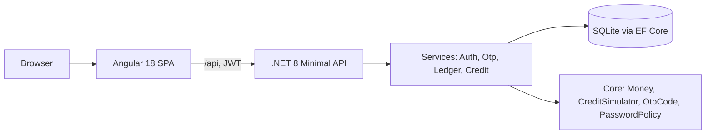
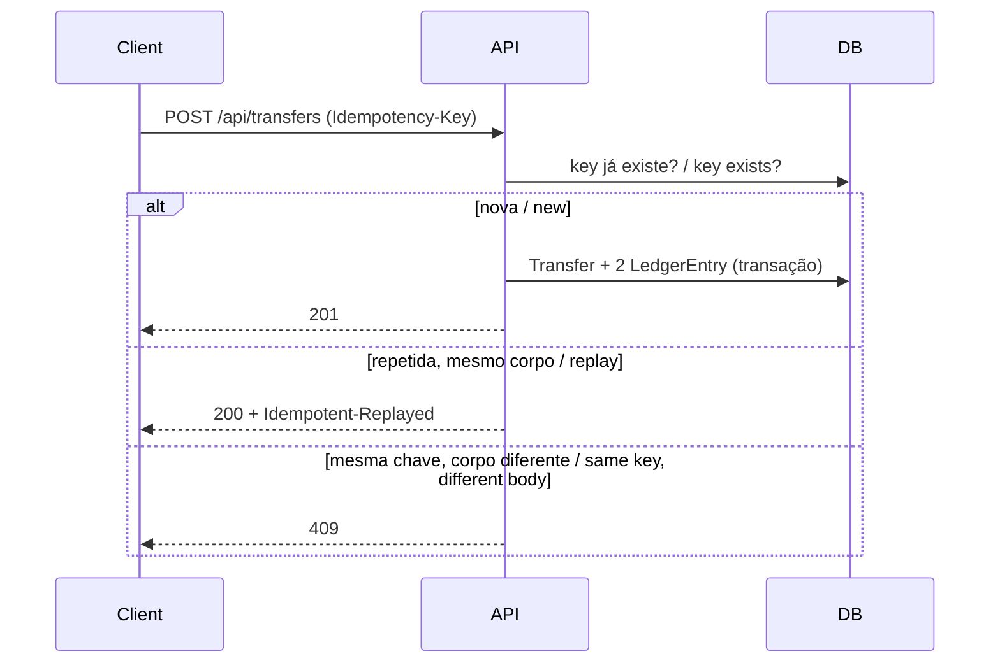

# Arquitetura / Architecture

- **Core**: regras puras, sem dependências / pure rules, no dependencies.
- **Api**: endpoints finos + serviços; EF Core.
- **Ledger**: toda movimentação gera lançamentos em partidas dobradas (débito/crédito); o saldo é a soma dos lançamentos. / Every movement creates double-entry rows; balance is their sum.

